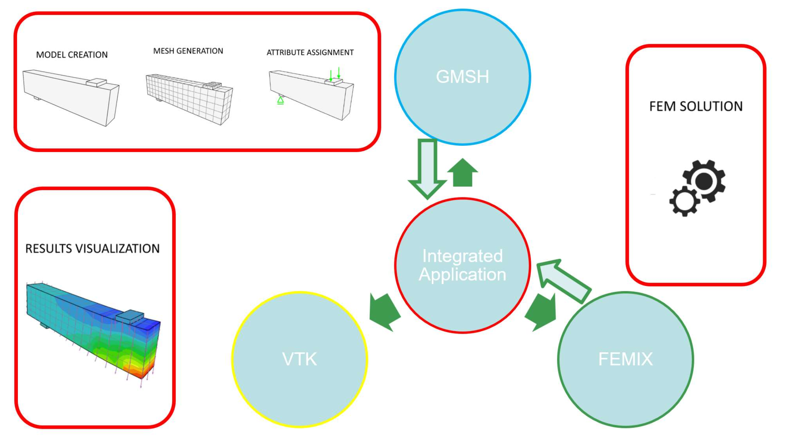
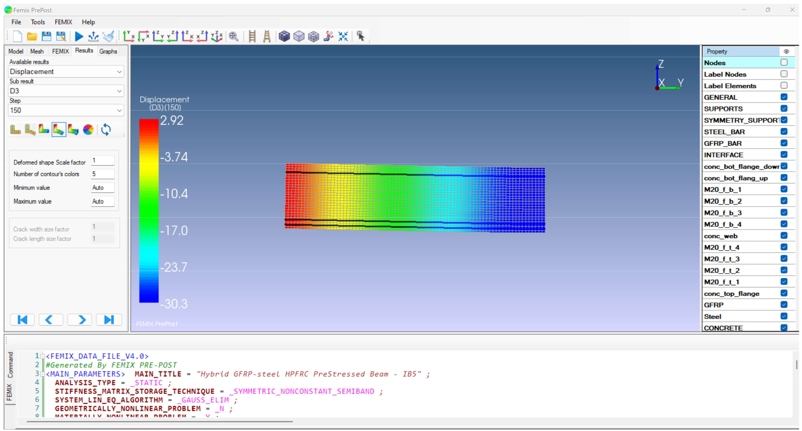
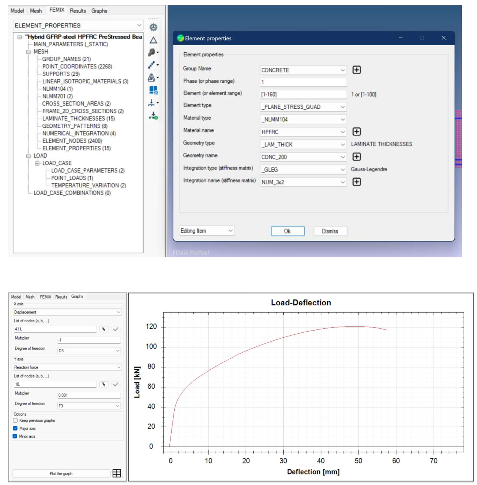

# FEMIX Pre-Post

**A C# Windows desktop application for preparing and reviewing finite element analyses using FEMIX, Gmsh and VTK.**

FEMIX Pre-Post was developed as a graphical environment to support the preparation of finite element models, mesh-generation workflows, FEMIX input data, analysis execution and visualization of numerical results. The application was developed in the context of research in structural engineering, including finite element modelling of concrete and fibre-reinforced concrete structural systems.

## Video Tutorials

### Software Introduction
[Software Introduction](https://youtu.be/iLN5GDLJ8jo?si=fQOdEINKnw6l9yvj)

### Tutorial
[Simulating the behavior of concrete beams flexurally reinforced with GFRP bars by FEMIX PrePost
](https://youtu.be/_vkdU3QoaBo?si=xuNjH8OeGr0qCTNu)

## Capabilities

The associated project documentation describes the following workflow and capabilities. The exact functionality available in each GUI module should be verified against the source code and tested with the required dependencies.

- GUI-based preparation and editing of finite element model data.
- Geometry and mesh-generation workflow using Gmsh.
- Preparation and validation of input data for the FEMIX solver.
- Definition and editing of model information such as material properties, supports, loading conditions, loading steps and finite element properties.
- Post-processing and visualization of FEMIX output, including displacement, stress, strain and crack-pattern information, using VTK.
- Handling of intersections between 1D line segments and quadrilateral elements or faces of 3D solid elements for embedded-element workflows.

Element families supported by the FEMIX solver are not necessarily all exposed or fully implemented in this GUI. Consult the code and test each feature before relying on it.

## Workflow

## Screenshots
Screenshots are not included in this starter package. Add screenshots of the actual application under `docs/images/`, and then embed them here. Suggested images are the main window, model/mesh generation, FEMIX input setup, and results visualization. Only add images you have the right to redistribute, and redact any private data or local file paths.

## Technology and dependencies

- **Language and UI:** C# and Windows Forms.
- **Target framework:** .NET Framework 4.8.
- **Project format:** Classic Visual Studio solution/project files (`Femix.sln`).
- **Meshing workflow:** Gmsh and the `GmshToFemix` project.
- **Finite element solver:** FEMIX. The solver is not identified as part of this source archive; users must obtain it separately and follow its own license terms.
- **Visualization:** The project references the legacy Kitware ActiViz.NET OpenSource Edition / VTK .NET wrapper, reported by the local binary as version 5.8.0 (revision 607), plus native runtime DLLs and the `Kitware.mummy.Runtime` wrapper (reported as version 1.0.2, revision 599).
- **Additional referenced libraries:** FastColoredTextBox (reported file version 2.16.26.0) and ZedGraph (reported file version 5.0.9.41461).

### Important dependency note

The local `Exe/` directory contains the compiled application and a set of third-party managed/native binaries. It is excluded from this source repository until the exact redistribution rights for each binary have been checked. The legacy project files reference some DLLs under `Exe/`, so a fresh clone **will not build until the required dependencies have been obtained and placed/configured appropriately**. See [`THIRD-PARTY-NOTICES.md`](THIRD-PARTY-NOTICES.md).

## Build on Windows

This is a legacy .NET Framework solution. Do not assume that `dotnet run` is the appropriate build workflow.

1. Install Visual Studio with the **.NET desktop development** workload.
2. Install the **.NET Framework 4.8 Developer Pack** if it is not already installed.
3. Clone the repository and obtain the third-party dependencies permitted for your use.
4. Open `Femix.sln` in Visual Studio.
5. Check that the external assembly references in `Femix/Femix.csproj` resolve. The project currently references DLLs under `Exe/`, including `FastColoredTextBox.dll`, `Kitware.mummy.Runtime.dll`, `Kitware.VTK.dll` and `ZedGraph.dll`.
6. Select a platform configuration compatible with the native VTK binaries. The validated x86/x64 configuration has not yet been established.
7. Set `Femix` as the startup project, then build and run it from Visual Studio.

The solution also contains `Setup/Setup.vdproj`. Building this installer project may require Microsoft's Visual Studio Installer Projects extension. The separate `FemixFRM/FemixFRM.csproj` exists in the local directory but is not listed in the supplied `Femix.sln`; its intended status should be clarified before documenting it as part of the standard build.

## 📥 Download and Installation

Download the latest Windows installer for FEMIX Pre/Post-Processor.

**[⬇️ Download FEMIX Pre/Post-Processor (.msi)](https://github.com/kamyarba/femix-prepost/releases/download/Femix-prepost/Femix_PrePost-Setup.msi)**

### Installation Instructions

1. Download `Femix_PrePost-Setup.msi` using the link above.
2. Double-click the downloaded `.msi` file.
3. Follow the installation wizard to complete the installation.
4. Launch FEMIX Pre/Post-Processor from the installed application or Start menu.

**Platform:** Windows

## Examples
The local project directory contains `.dat` files under `FemixSample/`. They are not included in this starter package because their provenance and redistribution permissions have not yet been confirmed. Add them only after checking that you can redistribute them and recording any required source attribution or benchmark citations.

## Research context

FEMIX Pre-Post was developed as part of research on computational modelling and finite element analysis of structural systems. The accompanying research documentation discusses the integration of model preparation, mesh generation, solver input preparation, numerical analysis and visualization.

For academic use, cite the version of the software that you used. See [`CITATION.cff`](CITATION.cff); after publishing a release on GitHub and archiving it in Zenodo, update the citation metadata with the repository URL and released version as appropriate.

## Project status

Research software originally developed for Windows and .NET Framework 4.8. Before wider use, the project needs a reproducible dependency setup, a clean build on another machine, documented dependency versions, and tests of representative model/mesh/solver/result workflows.

## License

Original FEMIX Pre-Post source code and project-authored documentation are licensed under **CC BY-NC-SA 4.0**, subject to the scope and exclusions in [`LICENSE`](LICENSE). This license requires attribution, restricts use to non-commercial purposes, and requires adaptations to be shared under the same or a compatible license. Read the [full legal code](https://creativecommons.org/licenses/by-nc-sa/4.0/legalcode) before reuse.

Third-party libraries, runtimes, solver files, sample models, logos and other materials are **not automatically covered by this license**. They remain subject to their respective terms. See [`THIRD-PARTY-NOTICES.md`](THIRD-PARTY-NOTICES.md).

## Disclaimer

This software is provided for research and engineering-analysis purposes. Users are responsible for independently checking geometry, mesh quality, element definitions, material parameters, boundary conditions, solver settings and interpretation of results before making engineering decisions. It is not a substitute for independent engineering verification.
